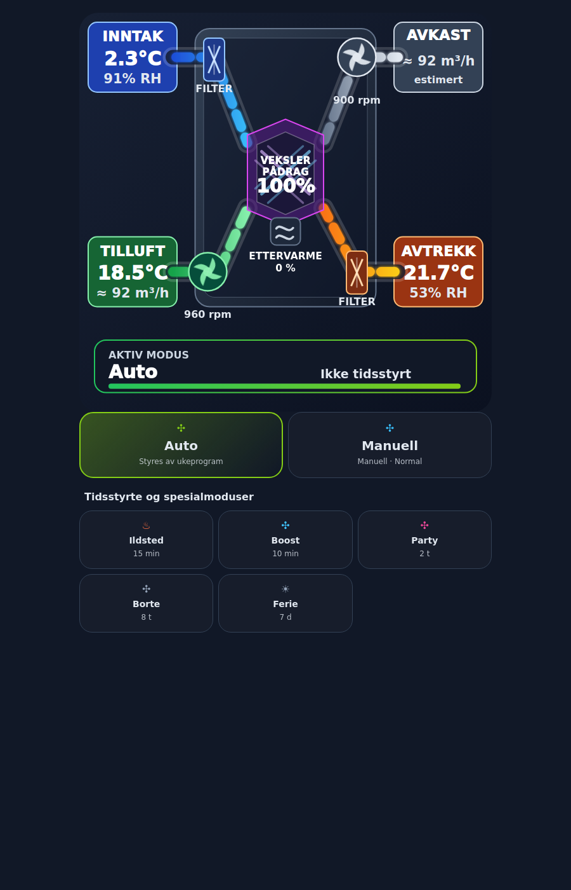
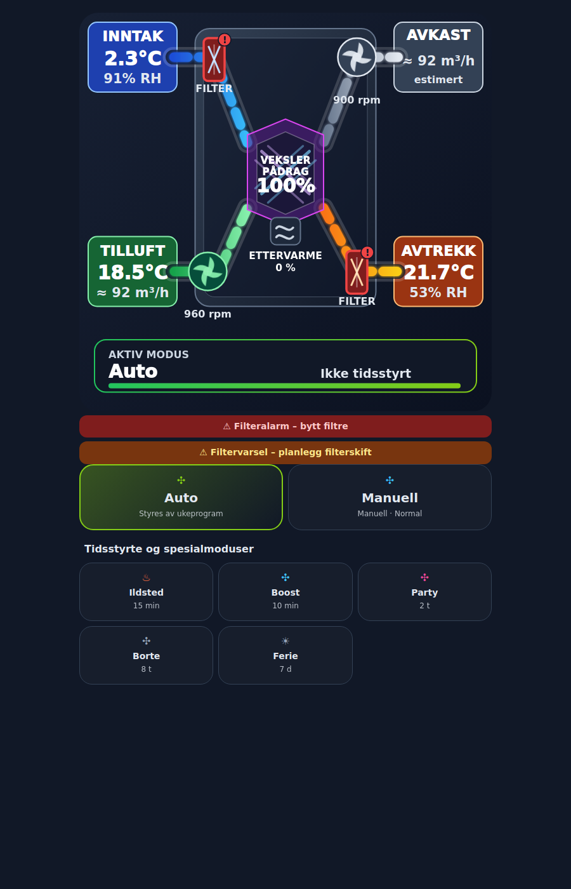
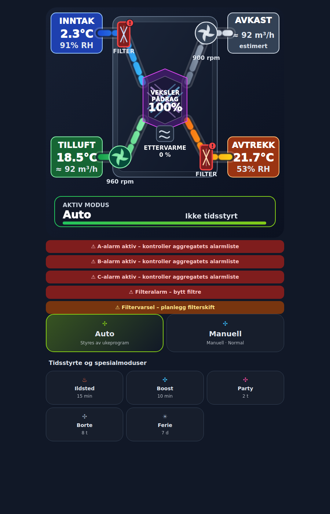

# VSR300 Cards

Two Home Assistant dashboard cards for **Systemair SAVE VSR300**, using
[Howard0000's Systemair Modbus integration](https://github.com/Howard0000/home-assistant-systemair-modbus):

| Card | Type | Purpose |
| --- | --- | --- |
| Systemair SVG | `custom:vsr300-svg-card` | Air path illustration, temperatures, estimated airflows, fan speeds, control outputs, filter status and remaining mode time. |
| Systemair Kontrollpanel | `custom:vsr300-control-card` | Operating mode buttons and configured durations. |

Both cards have a **graphical entity editor**. All labels currently use Norwegian.
Version **1.1.0** is recorded in the JavaScript header and configuration comments.
Both cards hide their headings by default. The SVG has no fixed footer text.

[Norsk installasjonsveiledning](README.nb.md) · [Entity bindings](ENTITETSKART.md) ·
[Changelog](CHANGELOG.md) · [Verification](VERIFIKASJON.md)



*Development preview with simulated Home Assistant values and placeholder icons.
Home Assistant supplies the actual Material Design icons. This is not a live
measurement or a screenshot from a connected ventilation unit.*

## Requirements and status

- Reference setup: **Home Assistant 2026.10.2** and **systemair_modbus 1.3.0**.
  The HACS manifest conservatively requires HA 2026.10.2. Other HA releases,
  integration versions and ventilation models have not been systematically tested.
- Set up the Systemair integration and its entities first. Entity IDs may vary
  with the installation, language and entity renaming.
- The cards use Home Assistant states and service calls. The integration owns
  Modbus communication; these cards do not open a connection to the unit.
- No local template sensors, helpers, Node-RED flows, button-card or card-mod are
  required for these two cards. Outdoor humidity is an optional external sensor.
- Local simulated-state and browser checks were completed. The maintainer has
  reported that initial testing of 1.0.0 in the actual HA installation works.
  Version 1.1.0 has not yet been checked on the actual Pixel 8 Pro or HA. Full
  graphical-editor, control and HACS installation acceptance checks remain open.
  See [VERIFIKASJON.md](VERIFIKASJON.md).

## Install with HACS

This repository is prepared for HACS as a **custom Dashboard repository**.
It has not been submitted to the HACS default repository list.

1. Open **HACS**, then its three-dot menu → **Custom repositories**.
2. Enter `https://github.com/stboee/vsr300-cards`.
3. Choose **Dashboard** and add the repository.
4. Open **VSR300 Cards** in HACS and download it. Until a GitHub release is
   published, HACS uses the default branch, `main`.
5. Check the dashboard resources in Home Assistant. The resource should be:
   - URL: `/hacsfiles/vsr300-cards/vsr300-cards.js`
   - Type: **JavaScript module**.
   HACS may add a cache/version query string to this URL; retain it.
6. Reload the browser page and add the cards as described below.

If resources are managed in dashboard YAML, the corresponding entry is:

```yaml
resources:
  - url: /hacsfiles/vsr300-cards/vsr300-cards.js
    type: module
```

### Migrating from the manual 1.0.0 installation

Keep your existing card configurations and entity selections. After HACS has
downloaded the file, replace the old `/local/vsr300/vsr300-cards.js?...` resource
with the HACS resource. Register **one active resource for this package**, then
fully reload each browser. Loading both copies can leave an older component
registered until the page is reloaded.

## Manual installation

1. Download [vsr300-cards.js](https://github.com/stboee/vsr300-cards/blob/main/vsr300-cards.js)
   using GitHub's **Download raw file** button.
2. Place it at `/config/www/vsr300/vsr300-cards.js` in Home Assistant.
3. Add a dashboard resource:
   - URL: `/local/vsr300/vsr300-cards.js?v=1.1.0`
   - Type: **JavaScript module**.
4. Reload the browser page.

No Home Assistant restart or backend configuration change is required for the
frontend resource itself.

## Add and configure the cards

1. Edit a dashboard and choose **Add card**.
2. Select **Systemair SVG** or **Systemair Kontrollpanel**.
3. Expand **Entitetskoblinger** in the graphical editor.
4. Select the matching entities from your Systemair installation and save.

For a manual card, these minimal configurations use the initial entity bindings:

```yaml
type: custom:vsr300-svg-card
```

```yaml
type: custom:vsr300-control-card
```

Complete configurations are provided in [examples/01-SVG.yaml](examples/01-SVG.yaml)
and [examples/02-Kontrollpanel.yaml](examples/02-Kontrollpanel.yaml).
The initial entity IDs come from the maintainer's setup. They are editable
presets, not automatic discovery and not universal entity names.

Once an `entities:` mapping has been saved, that mapping is authoritative.
Cleared or omitted fields in it remain empty; they are not silently rebound to
the presets. The graphical editor can fill missing mappings. Required mappings
that are absent are reported in the card.

The following mappings are optional:

- SVG: `outdoor_humidity`, `alarm_a`, `alarm_b`, `alarm_c`, and the five duration fields.
- Control panel: the five duration fields.

Duration fields must use the units shown in the editor: minutes, hours or days.
The `countdown` sensor must report **seconds**. See the complete role-to-entity
table in [ENTITETSKART.md](ENTITETSKART.md).

## Animation and appearance

The SVG editor offers **Animasjoner** with these choices:

| Editor choice | YAML value | Behaviour |
| --- | --- | --- |
| På (default) | `'on'` | Animates fan blades and air paths even when the device requests reduced motion. |
| Auto – følg enheten | `auto` | Follows the device's `prefers-reduced-motion` setting. |
| Av | `'off'` | Disables both animations. |

Quote `'on'` and `'off'` when editing YAML, so they remain strings. Existing
configurations without `animation` use `'on'`.

Both cards default to `show_title: false`, including older saved configurations
that still contain a title. To display a custom heading, enable **Vis overskrift**
and enter **Overskrift** in the editor.

### Updating existing cards from 1.0.0

After replacing the resource and reloading the browser, the headings are hidden,
the fixed footer is gone and animations default to on. Existing entity mappings
are retained. To use the new class alarms, select their entities in the SVG editor:
**A-alarm**, **B-alarm**, **C-alarm**. They are optional and are not silently added
to an existing saved `entities:` mapping. Complete initial examples include the
maintainer's mappings for these three roles.

## Meaning of the displayed values

- **Airflow is estimated**, marked with `≈`. It is supplied by the integration;
  it is not a physical airflow measurement. In the reference VSR300 setup the
  integration derives it from fan output and a nominal capacity of 368 m³/h.
- **Vekslerpådrag** is the reported heat-recovery control output. A value of
  100% is not a measured heat-recovery efficiency of 100%.
- **Ettervarme** shows reported heater output in percent, alongside a separate
  active/inactive indication. No watt estimate is calculated.
- **Exhaust temperature is omitted** because a physical source has not been
  verified on the reference unit.
- **Remaining time** comes from the selected integration countdown sensor.
  It is not decremented using the browser clock. Optional duration fields only
  provide a reference for the progress bar. Without them, reported remaining
  time can still be displayed.
- The air paths, fan animations and **utenom veksler** illustration are schematic.
  They do not establish the physical state of a bypass or a measured air path.
- Free-cooling status follows the integration's signal. Its IR4111 source in
  Howard v1.3.0 remains undocumented in the project's Systemair register list;
  comparison with documented IR3102 on the reference unit remains pending.
- Missing, `unknown` or `unavailable` measurements are not converted to valid zero
  measurements. Heater output and heater-active status are displayed separately.

## Filter indication

| Input | Display |
| --- | --- |
| Filter alarm on | Both filter symbols red with `!`; replacement message. |
| Filter warning on, without a known active alarm | Both symbols orange with `!`; plan replacement. |
| Both signals off | Normal filter symbols. |
| Insufficient information to establish an inactive state | Neutral symbols with `?`; status unknown. |

A known active alarm takes priority. A known active warning remains visible if
the alarm signal is unknown. This is a shared filter indication, not two
individual filter-condition measurements.



*Simulated alarm example with placeholder icons, not a live alarm report.*

## Alarm lines

Each active configured signal adds its own line below the SVG, in this order:
**A-alarm, B-alarm, C-alarm, filter alarm, filter warning**. Filter symbols retain
their alarm/warning priority independently of the list, so both a filter alarm
and filter warning can have a line while the symbols are red.

A/B/C are summary alarms; these entities do not identify the underlying fault.
Signals may overlap and the rows must not be interpreted as a count of distinct
faults. No alarm is acknowledged or reset from the card. Configured signals with
unknown/unavailable states get a neutral status-unknown line, rather than being
shown as active or treated as clear. Optional class-alarm fields left empty
produce no line.



*All five inputs are active in this simulated example.*

## Controls

The control panel offers **Auto, Manuell, Lav, Normal, Høy, Ildsted, Boost, Party,
Borte and Ferie** through the integration's existing button/select entities.
Special modes require confirmation. Highlighting follows the reported mode,
rather than assuming a successful mode change after a button press. Service
errors are shown in the card.

Button durations are configured durations, not countdown values. A Home
Assistant button can legitimately have state `unknown` before its first press.
Missing or `unavailable` command entities disable their controls.

There are no **Stop** or **Filter changed/reset** controls.

## Updates and troubleshooting

- With HACS, download an update there and reload the browser. Keep existing card
  configurations and entity mappings.
- With manual installation, replace the JavaScript file and change the version
  query string on the resource URL, then reload the browser.
- **Custom element doesn't exist:** check the resource URL, module type and
  browser reload first.
- **Mangler entitetskobling:** open the card editor and select the missing roles.
- **No graphical editor:** check the HA version and that the updated resource
  has actually loaded. Configuration YAML remains available.

The separate local Forklaringer card and the maintainer's diagnostic/trend cards
are outside this package. This repository does not install or change them.

## License and sources

[MIT](LICENSE). The existing repository copyright notice is retained.
See [SOURCES.md](SOURCES.md) for project provenance, external documentation and
the scope of the dependency/license review. This is a community project.

## Primary documentation

- [Home Assistant custom cards](https://contributors.home-assistant.io/frontend/custom-ui/card/)
- [Home Assistant graphical editor](https://contributors.home-assistant.io/frontend/custom-ui/card-editor/)
- [Howard integration v1.3.0](https://github.com/Howard0000/home-assistant-systemair-modbus/tree/v1.3.0)
- [HACS dashboard repository requirements](https://www.hacs.dev/docs/publish/plugin/)
- [HACS custom repositories](https://www.hacs.dev/docs/faq/custom_repositories/)
