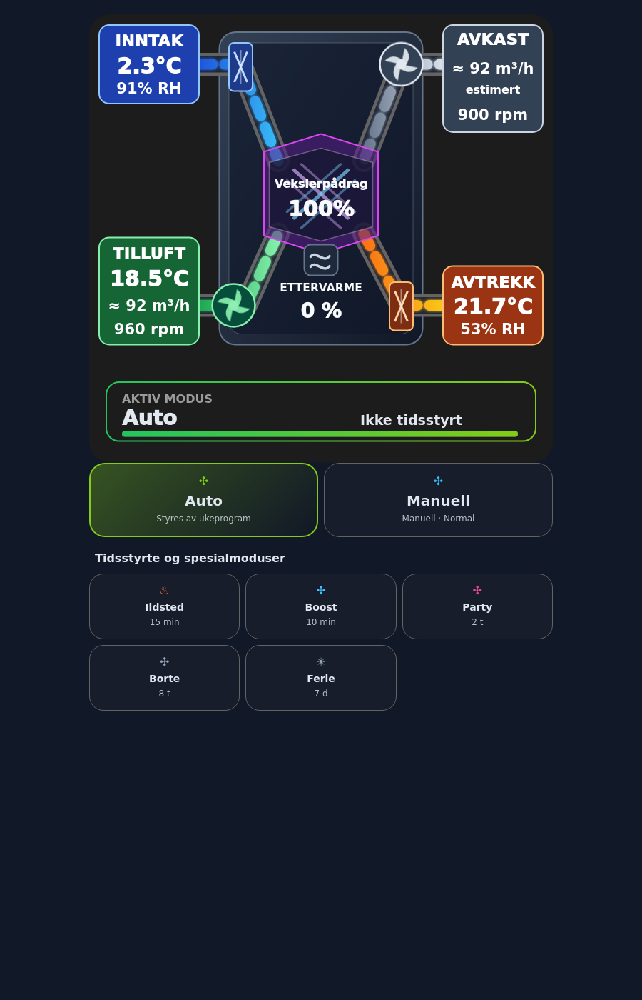
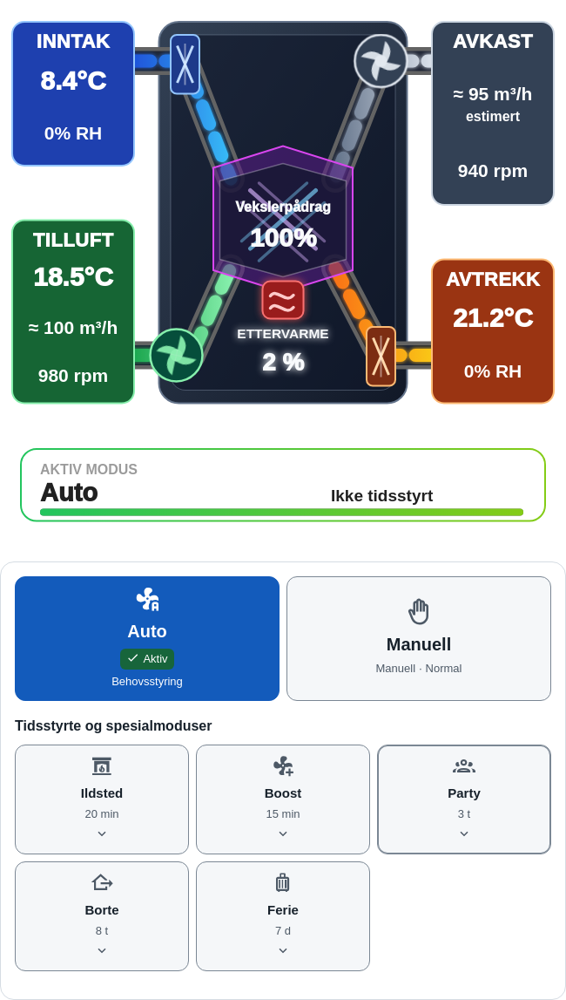
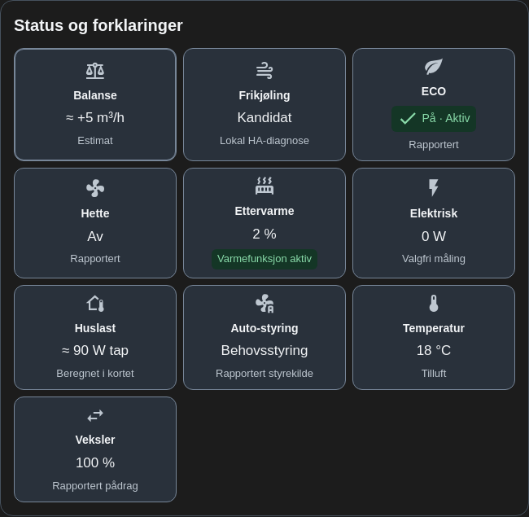

# VSR300 Cards

Three Home Assistant cards for Systemair SAVE VSR300: **Systemair SVG**,
**Systemair Kontrollpanel**, and optional **Systemair Status og forklaringer**,
with graphical entity selection. Current card
version: **1.2.2**. Reference setup: HA 2026.10.2 and
[Howard systemair_modbus 1.3.0](https://github.com/Howard0000/home-assistant-systemair-modbus).

[Norsk veiledning](README.nb.md)

## Install with HACS — custom repository

1. In HACS, open the three-dot menu and select **Custom repositories**.
2. Add **`https://github.com/stboee/vsr300-cards`**, select type **Dashboard** (Plugin/Lovelace in older HACS versions), and add the repository.
3. Open VSR300 Cards in HACS and download the latest release.
4. Under **Settings → Dashboards → Resources**, check that the HACS resource is present as a **JavaScript module**: `/hacsfiles/vsr300-cards/vsr300-cards.js`. Keep any query string managed by HACS. If the resource is missing, add it once.
5. Fully reload the browser and add **Systemair SVG**, **Systemair Kontrollpanel** and optionally **Systemair Status og forklaringer** from the dashboard card picker. Adapt the entities in every card you use.

When switching from manual installation, replace the old
`/local/vsr300/vsr300-cards.js?...` resource with the HACS resource so that the
same cards are loaded only once. Keep the existing card configurations.

## Manual installation

1. Download [vsr300-cards.js](vsr300-cards.js) using GitHub's **Download raw file** button.
2. Copy it to `/config/www/vsr300/vsr300-cards.js` in Home Assistant. Create the `vsr300` folder if needed.
3. Add a dashboard resource with URL **`/local/vsr300/vsr300-cards.js?v=1.2.2`** and type **JavaScript module**.
4. Fully reload the browser, edit the dashboard and add the cards you want from the card picker.

## Configure the cards

**Adapt the entity bindings in every card you use, regardless of installation method.**
Open **Entitetskoblinger**, check every field and replace the example IDs with
the matching entities from your own Home Assistant installation. Clear optional
fields you do not use.

Complete YAML configurations are available in [01-SVG.yaml](examples/01-SVG.yaml),
[02-Kontrollpanel.yaml](examples/02-Kontrollpanel.yaml), and
[03-Status-og-forklaringer.yaml](examples/03-Status-og-forklaringer.yaml). **When using these
examples, also check and adapt every entity ID under `entities:` before using
the cards.** The prefilled IDs are installation-specific examples.
The frontend file itself does not require a Home Assistant restart.

## Updates

**HACS:** install the offered update in HACS, then fully reload the browser,
including mobile devices. HACS manages the downloaded file and resource version;
there is no need to edit a version query manually. Keep existing card
configurations and entity selections. If the release is not yet shown, use
**Update information** in the repository menu, then download the update.

**Manual:** replace the JavaScript file, change the resource URL's version query
to match that file, and fully reload the browser. Keep existing configurations.

When upgrading from 1.0.0, select the optional **A-alarm**, **B-alarm** and
**C-alarm** entities in the SVG editor to display these summary alarms.

## Add the explanations card after updating

Updating the file does not add a dashboard card automatically. Add **Systemair
Status og forklaringer** from the picker, or use:

```yaml
type: custom:vsr300-explanations-card
```

Check its entity bindings. Your initial presets are examples, including optional
local diagnosis and electrical-meter entities. Clear optional fields you do not
use. Keep the old YAML card until the new card's configuration is checked, then
replace it. The SVG and control card configurations stay as they are.

## Tap values in the SVG card

Tap a value row to open its mapped entity in Home Assistant's standard more-info
dialog, with whatever history HA has recorded. The whole row is a target, using
the existing entity mappings in the visual editor. No helpers or additional
configuration are required.

- Each temperature, humidity, estimated airflow and RPM row opens separately.
- Fan symbols open their RPM sensor. The exchanger opens recovery output;
  when free cooling is displayed, that component opens reported cooling status.
- The heater symbol/label opens the active-status binary sensor; the percentage
  opens the output sensor. These remain distinct signals.
- Filters open the active alarm ahead of warning, or the alarm entity when both
  are inactive. Each alarm row opens its own entity.
- Mode and remaining time open separately. Countdown history contains integration
  reports, while the visible card ticks locally between reports.

The side boxes are taller with more row spacing, preserving top/bottom alignment,
overall SVG width and font sizes. Tab, Enter and Space are supported. An existing
unavailable entity still opens; empty or nonexistent mappings have no action.
These actions only open entity details; they do not control the unit. Airflows
remain estimates, recovery output remains a reported control output rather than
thermal efficiency, and no new history is created by the card.

## Options and displayed values

- The outer cockpit background and mode panel follow the active Home Assistant theme. The unit and heat exchanger retain a dark appearance with light text in both light and dark themes. Air-port and alarm colours retain their meaning.
- Fan RPM is shown in the taller Tilluft and Avkast information boxes. Inntak and Avkast align with the unit top; Tilluft, Avtrekk and the unit share one bottom edge. Heater percentage is enlarged; Vekslerpådrag appears on one line. Filter symbols and warning badges remain visible without separate FILTER captions.
- Animations: **På** (default), **Auto – følg enheten**, or **Av**. On animates even when the device requests reduced motion; Auto follows that preference.
- SVG and control headings are hidden by default. The explanations card shows its heading by default. **Vis overskrift** and the title field configure this per card.
- Remaining mode time counts down locally each second between integration reports and resynchronises with new reports. This is a display estimate; the active mode continues to come from the integration.
- `≈` marks the integration's estimated airflow. **Vekslerpådrag** is control output, not measured heat-recovery efficiency. Heater output is shown in percent, without a watt estimate.
- Each active configured alarm signal gets its own row. A/B/C are summary alarms and may overlap other indications.
- The air paths and animations are schematic.
- **Status og forklaringer** has eight status tiles and explanations, local open/close selection (tap the same tile again to close), three columns on mobile, calculated house load, and optional measured power. It needs neither an input_select helper nor button-card. Local free-cooling diagnosis and 24-hour maximum are optional existing HA sources, clearly separate from integration reports. See [explanations card and migration](EXPLANATIONS.md).







*Simulated values and placeholder icons; Home Assistant supplies the actual icons.*

[Entity bindings](ENTITETSKART.md) · [Changelog](CHANGELOG.md) ·
[Verification and test limits](VERIFIKASJON.md) · [Sources](SOURCES.md) · [MIT license](LICENSE)
