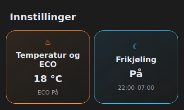
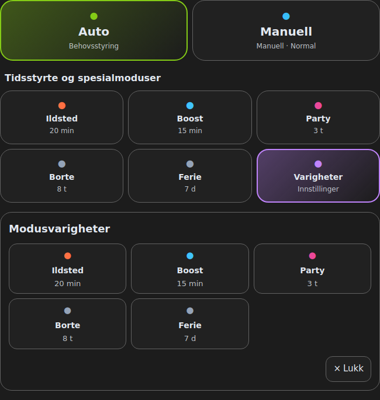
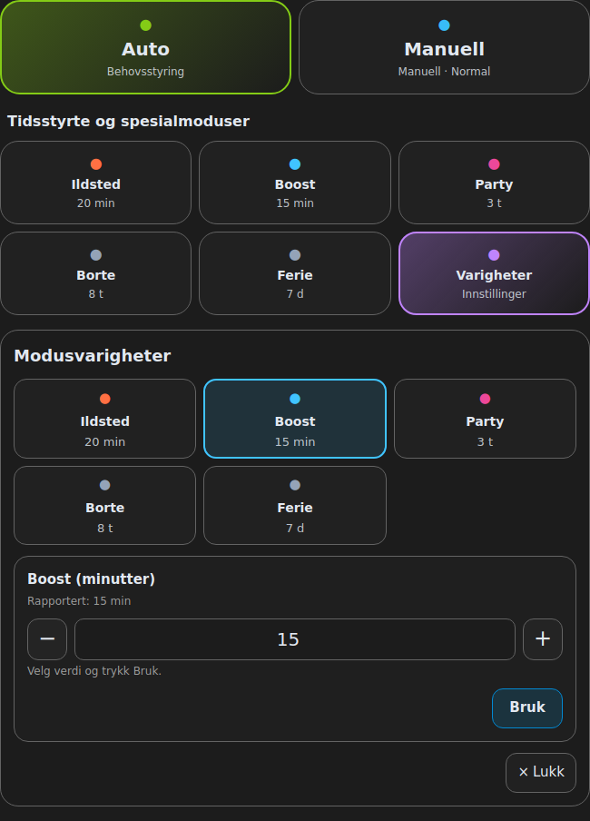

# Innstillinger – kortpakke 1.4.1

Et valgfritt fjerde kort i samme JavaScript-pakke. Oppdater gjennom HACS,
last dashboardet på nytt og legg til **Systemair Innstillinger** fra kortvelgeren:

```yaml
type: custom:vsr300-settings-card
```

Et komplett eksempel finnes i [04-Innstillinger.yaml](examples/04-Innstillinger.yaml).
Kontroller entitetskoblingene i grafisk editor. Startverdiene er eksempler fra
referanseoppsettet. Tøm valgfrie felt som ikke brukes.

## To temaer

| Tema | Innhold |
|---|---|
| Temperatur og ECO | Temperatursettpunkt, ECO-valg, senking av ettervarmegrensen og kort avlesning av reguleringsmåte. |
| Frikjøling | Tillatelse, separat aktiv-status, start/slutt, temperaturgrenser og minste tilluft-/avtrekksnivå. |

Trykk på et temafelt for å åpne det, og på samme felt igjen for å lukke.
Temaene kan skjules enkeltvis i editoren. Utvidede grenser ligger under
**Flere innstillinger**. Systeminformasjon er tatt ut av kortet fra 1.4.1.

## Endre et valg

- **Tall:** skriv en verdi eller bruk pluss/minus, og velg **Bruk**. Grenser og
  trinn hentes fra entitetens `min`, `max` og `step`. Manglende metadata eller
  utilgjengelig verdi deaktiverer redigeringen; kortet gjetter ikke grenser.
- **Brytere:** trykk På/Av for ECO eller frikjøling. Ukjent status gir ingen handling.
- **Klokkeslett:** velg start/slutt og trykk Bruk. Native klokkevelgere følger
  nettleserens visning; tiden sendes som time og minutt.
- **Viftenivå:** velg et av alternativene HA leverer, og trykk Bruk.

Ulagrede valg beholdes ved vanlige HA-oppdateringer. Endring av kortoppsett
rydder utkast. **Innstilling sendt** er en kvittering på tjenestekallet;
rapportert verdi endres først ved nye HA-data. Feil beholder utkastet.
Nye innsendinger blokkeres mens et kall pågår.

Klokkeslett bruker to number-entiteter. Begge valideres før sending, men
endringen er ikke atomisk. Delvis feil vises uten automatisk tilbakerulling.

## Modusvarigheter i Kontrollpanel

**Varigheter**, ved siden av Ferie, åpner fem kompakte valg med gjeldende tid.
Velg en modus for å vise ett felt; nytt trykk på samme valg lukker feltet.
Pluss/minus og Bruk vises bare for den valgte, redigerbare varigheten.

Ildsted er en sensor i referanseintegrasjonen og vises som avlesning med
mulighet for native HA-detaljer/historikk. Den endres i Systemair-appen eller
på aggregatets panel. Boost, Party, Borte og Ferie bruker native number-entiteter.
Å velge en varighet starter ingen modus. Vanlig modusbetjening beholdes.

Lukking av hele panelet nullstiller valgt modus og beholder utkastene. Neste
åpning viser bare de kompakte valgene. Kontroller varighetskoblingene i
Kontrollpanelets editor; egne navn flyttes ikke automatisk mellom separate kort.

## Fordeling og avgrensning

| Opplysning eller funksjon | Plassering |
|---|---|
| Temperaturer, luftmengdeestimater og RPM | Cockpit og relevante forklaringer. |
| Temperaturregulering og ECO-prinsipp | Temperatur- og ECO-forklaringen; settpunkt/valg i Innstillinger. |
| Behovsstyringens sesong | Auto-forklaringen. |
| Filtervarsler og grafikk | Cockpit. Filterskift og periode endres på aggregatets panel. |
| Modus og varighet | Kontrollpanel. |
| Integrasjons- og HA-opplysninger | HAs egne enhets-/integrasjonssider. |

Betjening bruker bare `number.set_value`, `select.select_option` og eksplisitt
`switch.turn_on` / `switch.turn_off` på valgte entiteter. Howard eier Modbus.
Kortet lager ingen helpers, sensorer, automasjoner eller bakgrunnspolling.
Det finnes ingen Stopp- eller Filter byttet-knapp i pakken.

Gamle System-, filter-, temperatur- og varighetskoblinger i Innstillinger kan
bli liggende i eldre YAML, men vises ikke og kan ikke skrives fra kortet.
Gamle Filter-koblinger i forklaringskortet er også ubrukte. De kan ryddes
manuelt uten å slette HA-entitetene. Cockpits filterkoblinger skal beholdes.

Cockpit er uendret bortsett fra versjonen. Behold gamle Service-kort til ønsket
funksjonalitet er kontrollert i egen HA. De originale YAML-kortene og lokale
HA-filene endres ikke av kortpakken. Huslast beregnes fortsatt i forklaringskortet.

## English quick guide

Settings has two sections: temperature/ECO and free cooling. Mode durations are
in the control card: open Varigheter, then select one of five mode choices.
At most one editor is shown. Opening/closing sends no commands, and closing
retains drafts but resets selection. Ildsted remains read-only.

Verify entity bindings in each card. Retired System and Filter fields are
ignored; Cockpit filter alarms remain available. Native limits, explicit Apply,
error reporting and integration-owned Modbus communication are preserved.






